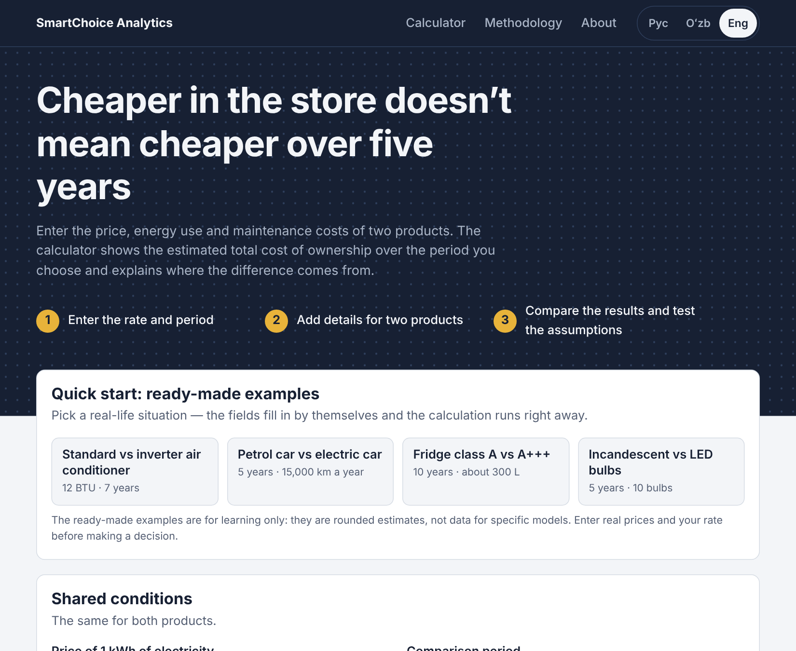
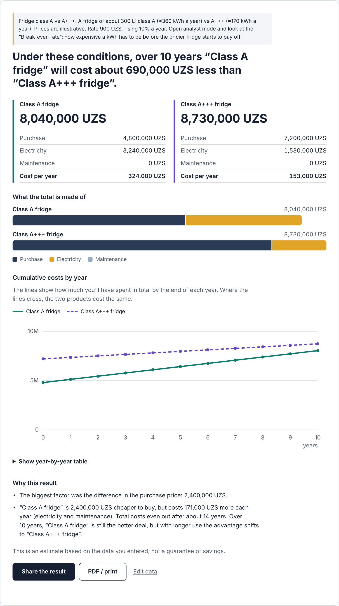
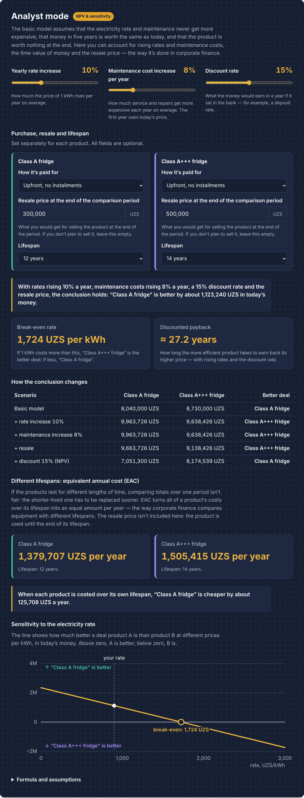
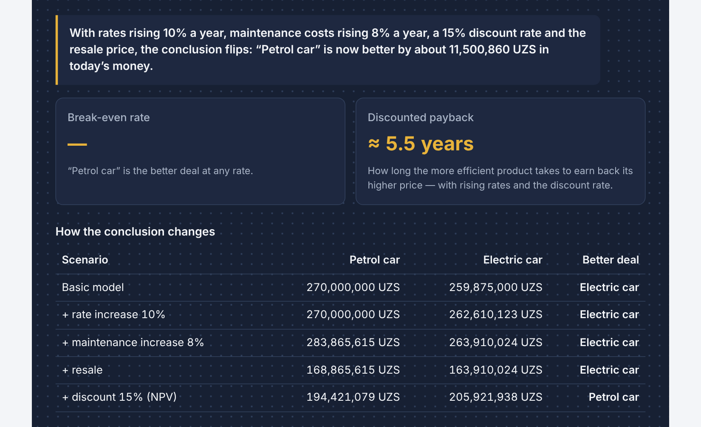
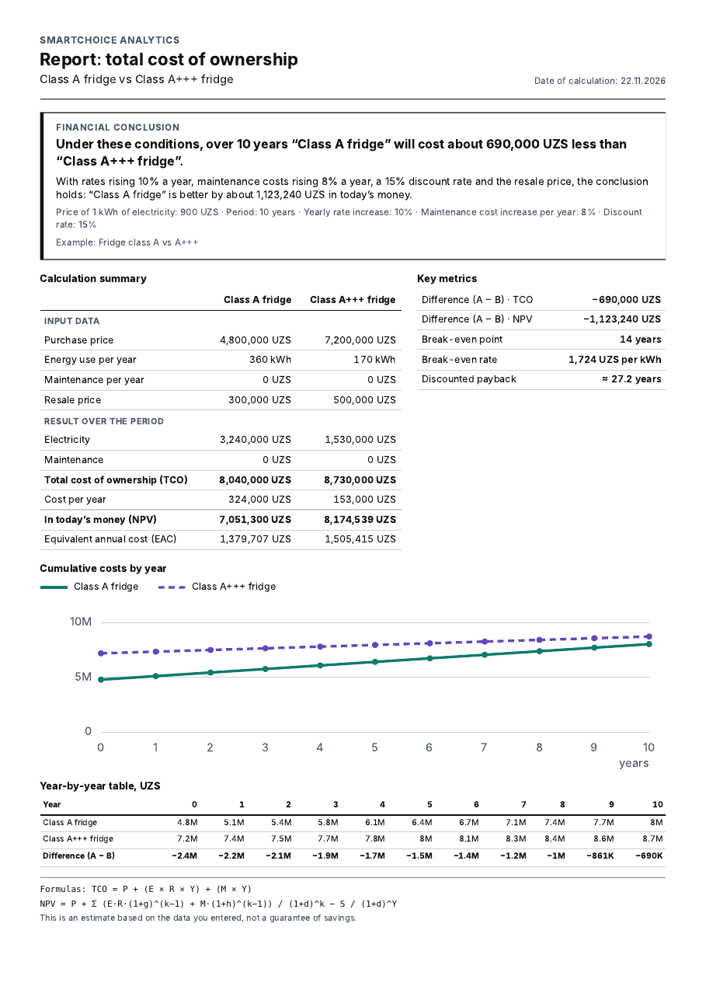
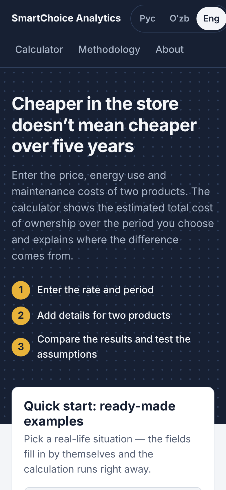

# SmartChoice Analytics

**A free, no-sign-up calculator that shows what a product really costs over its life, not just what the price tag says.**

**Live demo:** <https://saidjonstudy.github.io/smartchoice-ai/?lang=en> · Interface languages: English, Russian, Uzbek (`?lang=en`, `?lang=ru`, `?lang=uz`)



---

## Table of contents

1. [The problem](#the-problem)
2. [What the tool does](#what-the-tool-does)
3. [Case study: four decisions, one model](#case-study-four-decisions-one-model)
4. [The financial model](#the-financial-model)
5. [Design decisions](#design-decisions)
6. [Using the site](#using-the-site)
7. [Quality checks](#quality-checks)
8. [Limitations](#limitations)
9. [Data sources for the examples](#data-sources-for-the-examples)
10. [Project structure and running locally](#project-structure-and-running-locally)
11. [Author and use of AI](#author-and-use-of-ai)

---

## The problem

A price tag shows only the first payment. A fridge, an air conditioner or a car is used for years, and during that time the owner keeps paying for electricity, fuel and maintenance, while the product slowly loses its resale value. Often these running costs are larger than the price difference at the shop. A model that is cheaper to buy can be more expensive to own, and the opposite is also true.

Three things make this hard to judge by eye:

- **Time.** Costs spread over years are hard to add up in your head, and money paid in five years is not worth the same as money paid today.
- **Moving prices.** In Uzbekistan household electricity tariffs are tiered by monthly consumption and are indexed every year, so a "cheap to run" product gets cheaper to run relative to a "cheap to buy" one as the tariff rises.
- **Hidden assumptions.** Most comparisons silently assume that nothing changes. The honest question is not "which is cheaper?" but "under which assumptions is it cheaper, and how sensitive is the answer?"

SmartChoice Analytics makes those assumptions visible and lets the user change them.

## What the tool does

**Basic model (for everyone).** Enter the electricity tariff, the comparison period and, for two products, the purchase price, yearly energy use and yearly maintenance cost. The site shows:

- total cost of ownership (TCO) for each product, split into purchase, electricity and maintenance;
- cumulative cost by year as a chart and a table, and the break-even point where the cheaper-to-run product catches up;
- a plain-language explanation of where the difference comes from, with a warning when the difference is too small to trust.

**Analyst mode (for finance-minded users).** It appears under the result and adds:

| Feature | What it answers |
|---|---|
| Yearly electricity tariff growth | What if the tariff keeps rising? |
| Yearly maintenance cost growth | What if service and repairs get more expensive? |
| Discount rate (NPV) | What are future costs worth in today's money? |
| Resale price at the end of the period | How much of the purchase price comes back? |
| Instalment plan (3–36 months, 0–60 % a year) | What does buying on credit really cost? |
| Different service lives (EAC) | How do two products compare when one lasts longer? |
| Break-even tariff | At what electricity price do the two products cost the same? |
| Discounted payback | How many years until the extra price is earned back? |
| Sensitivity chart | How does the winner change as the tariff changes? |
| Scenario table | Which assumption flips the conclusion? Each assumption is added one step at a time. |

**Convenience features.**

- Four ready-made real-life cases (below) that fill in all fields and run the calculation.
- A shareable link that stores the whole comparison in the address (no server needed).
- A clean one-page A4 report for **PDF / print**: conclusion, summary table, chart and year-by-year table, without menus or forms.
- Works on phones, supports dark mode, keyboard navigation and reduced-motion settings.
- **Privacy:** everything is calculated in the browser. Nothing is sent anywhere, and there are no accounts or cookies.



## Case study: four decisions, one model

The site ships with four ready-made cases. The figures are rounded, illustrative estimates (see [Data sources](#data-sources-for-the-examples)). All results below are produced by the calculator itself with the preset assumptions: tariff growth 10 % a year, maintenance growth 8 % a year, discount rate 15 %.

### 1. Fridge class A vs class A+++ (10 years)

| | Class A | Class A+++ |
|---|---:|---:|
| Purchase price | 4,800,000 | 7,200,000 |
| Energy use per year | 360 kWh | 170 kWh |
| Resale price after 10 years | 300,000 | 500,000 |

The tariff is 900 UZS per kWh. The table shows how the verdict moves as assumptions are added:

| Scenario | Class A | Class A+++ | Better deal |
|---|---:|---:|---|
| Basic model | 8,040,000 | 8,730,000 | **Class A** |
| + tariff growth 10 % | 9,963,726 | 9,638,426 | **Class A+++** |
| + maintenance growth 8 % | 9,963,726 | 9,638,426 | Class A+++ |
| + resale price | 9,663,726 | 9,138,426 | Class A+++ |
| + discount rate 15 % (NPV) | 7,051,300 | 8,174,539 | **Class A** |

**Finding.** The more efficient fridge is not automatically the cheaper one. Rising tariffs favour it, but once future savings are discounted to today's money, the 2.4 million price premium is not earned back. The break-even tariff is **1,724 UZS per kWh**, about 1.9 times the assumed 900. The discounted payback is about 27 years, longer than the fridge lasts. The answer depends on the tariff, the period and the discount rate, and the tool shows exactly how.



### 2. Petrol car vs electric car (5 years, 15,000 km a year)

| | Petrol car | Electric car |
|---|---:|---:|
| Purchase price | 190,000,000 | 240,000,000 |
| Fuel and service (entered as yearly maintenance) | 16,000,000 | 1,500,000 |
| Electricity | – | 2,250 kWh a year at 1,100 UZS |
| Resale price after 5 years | 115,000,000 (≈60 %) | 100,000,000 (≈42 %) |

| Scenario | Petrol car | Electric car | Better deal |
|---|---:|---:|---|
| Basic model | 270,000,000 | 259,875,000 | **Electric car** |
| + resale price | 168,865,615 | 163,910,024 | Electric car |
| + discount rate 15 % (NPV) | 194,421,079 | 205,921,938 | **Petrol car** |

**Finding.** The basic model says the electric car is cheaper by about 10 million. Once all amounts are converted to today's money (15 % discount rate), the electric car's 50 million higher upfront payment outweighs its running-cost savings, and its lower resale value widens the gap. The conclusion **flips**: the petrol car is better by about 11.5 million. The point is not that one type of car is better. The point is that this decision hinges on one uncertain assumption (resale value), and the model makes that visible instead of hiding it.



### 3. Standard vs inverter air conditioner (7 years)

The inverter unit costs 1.3 million more (4.3 vs 3.0 million) but uses 600 instead of 1,000 kWh a year.

- Basic model: the inverter saves about **1.0 million** over 7 years.
- With all assumptions (NPV): the inverter is still better by about **548,000** in today's money.
- Break-even tariff: **644 UZS per kWh**, well below the 900 assumed, so the result is robust.
- Discounted payback: about **4.9 years**. Equivalent annual cost: 1,828,152 vs 2,044,137 per year.

**Finding.** A case where the efficient product wins under every assumption, in contrast to the fridge.

### 4. Incandescent vs LED bulbs (5 years, 10 bulbs, 4 hours a day)

LED costs more upfront (250,000 vs 30,000) but uses 131 instead of 876 kWh a year and does not need yearly replacement. TCO is 839,500 vs 4,122,000, and the discounted payback is about 0.4 years. This is the "obvious" case that sanity-checks the model.

## The financial model

### Basic model

$$TCO = P + E \cdot R \cdot Y + M \cdot Y$$

| Symbol | Meaning |
|---|---|
| P | purchase price |
| E | energy use per year (kWh); 0 if the product does not use electricity |
| R | price of 1 kWh |
| Y | comparison period in years |
| M | maintenance (and other running costs) per year |

The break-even point of two products is where their cumulative cost lines cross: $t = \dfrac{P_B - P_A}{A_A - A_B}$, with $A = E\,R + M$ the yearly running cost.

### Analyst mode: net present value

$$NPV = P_{pv} + \sum_{k=1}^{Y} \frac{E\,R\,(1+g)^{k-1} + M\,(1+h)^{k-1}}{(1+d)^{k}} - \frac{S}{(1+d)^{Y}}$$

| Symbol | Meaning |
|---|---|
| g | yearly growth of the electricity tariff |
| h | yearly growth of maintenance cost |
| d | discount rate (for example a bank deposit rate) |
| S | resale price at the end of the comparison period |
| P<sub>pv</sub> | purchase cost in today's money: the price itself when paid at once, or the present value of instalments (below) |

Conventions: running costs are paid at the end of each year; the first year uses today's prices; the resale price is received at the end of year Y. With g = h = d = 0 and S = 0 the formula reduces exactly to the basic TCO.

### Instalment plans

Monthly payment (annuity): $PMT = \dfrac{P\,i}{1 - (1+i)^{-n}}$, where $i = r/12$ and r is the yearly interest rate (r = 0 gives P / n). The payments are discounted with the monthly rate equivalent to d, $d_m = (1+d)^{1/12} - 1$:

$$P_{pv} = \sum_{m=1}^{n} \frac{PMT}{(1+d_m)^{m}}$$

### Different service lives: equivalent annual cost

If product A lasts 12 years and B lasts 9, comparing totals over one fixed period is unfair. The equivalent annual cost spreads the NPV over the service life L with the capital recovery factor:

$$EAC = NPV_L \cdot \frac{d}{1 - (1+d)^{-L}}$$

It assumes the product is replaced by an identical one when its life ends. The resale price is deliberately **not** included in the EAC, because the product is used until the end of its service life.

### Break-even tariff

With $F = \sum_{k=1}^{Y} \frac{(1+g)^{k-1}}{(1+d)^k}$ and $G = \sum_{k=1}^{Y} \frac{(1+h)^{k-1}}{(1+d)^k}$, the NPVs of A and B are equal when

$$R^{*} = -\,\frac{(P_A - P_B) + (M_A - M_B)\,G - \left(S_A - S_B\right)/(1+d)^{Y}}{(E_A - E_B)\,F}$$

The site reports R\* only if it is positive and the two products use different amounts of electricity. Above R\* the product that uses less energy wins; below it the other one does.

### Discounted payback

The first year at which the cumulative present-value costs of the two products meet (linear interpolation between years, up to 30 years). The resale price is excluded because it is only known for the end of the period.

## Design decisions

- **TCO first, NPV second.** The basic model has no hidden assumptions and is easy to audit. The analyst mode adds one assumption at a time, and the scenario table shows which one changes the conclusion.
- **Report the sensitivity, not just a verdict.** The break-even tariff and the sensitivity chart answer "how wrong can my input be before the answer changes?"
- **Neutral wording.** The site says "under these conditions, X costs about N less", not "buy X". Differences below 3 % are flagged as too small to trust.
- **Strict input validation.** Empty, negative, non-numeric or implausible values (for example a resale price above the purchase price, or more than 20,000 kWh a year) get a specific message next to the field.
- **No AI in the calculator.** Every number comes from the open formulas above. There is no neural network, no machine learning and no server.
- **One static file.** `index.html` contains the markup, styles, translations and logic. There is no build step or dependency, so it runs from GitHub Pages or from a double click, and every formula can be read in one place.
- **Three languages from one dictionary.** Number formats follow the language (`4 000 000` in Russian and Uzbek, `4,000,000` in English).
- **Accessible by default.** Labelled fields, `aria-live` results, visible focus, keyboard-only use, dark mode and reduced-motion support.

## Using the site

1. Open the live demo (add `?lang=en` for English) and press one of the ready-made cases, or enter your own numbers.
2. Read the verdict and the chart, then scroll to **Analyst mode** to change tariff growth, maintenance growth, discount rate, instalments, resale price and service life.
3. Use **Share the result** to copy a link, or **PDF / print** for a one-page report. In the print window choose *Save as PDF*. Printing needs a regular browser tab: built-in browsers (for example inside Telegram) and file previews can block the print window, and the site then shows a hint.



### URL parameters

| Parameter | Example | Effect |
|---|---|---|
| `?lang=` | `?lang=en` | Opens the site in English (`en`, `ru` or `uz`). It overrides the saved choice and the browser language, which is useful for links in applications and CVs. |
| `#…` | `#t=900&y=10&ap=4800000&ae=360&am=0&as=300000&bp=7200000&be=170&bm=0&bs=500000&g=10&h=8&d=15&lang=en` | A shared comparison: `t` tariff, `y` years, `a*`/`b*` for products (`p` price, `e` energy, `m` maintenance, `s` resale price, `n` name, `t`/`r` instalment months and yearly percent, `l` service life), `g` tariff growth %, `h` maintenance growth %, `d` discount rate %. |

The two can be combined: `…/smartchoice-ai/?lang=en#t=900&y=10&…`.



## Quality checks

- `tests.html` runs the calculation checks in the browser (cost formula, NPV, annuity, EAC).
- During development the new NPV, break-even tariff and EAC code was cross-checked against an independent re-implementation in Python on 300 random inputs, and the relative difference stayed below 10<sup>-9</sup>. With h = 0 and S = 0, the results matched the previous version of the code exactly on another 300 random inputs.
- The break-even identity was checked numerically: at the reported tariff R\*, the NPVs of the two products are equal.
- The print layout was checked as a PDF in all three languages for every ready-made case and for stress cases (30 years, long product names, instalments, resale price and different service lives together): it always fits on one A4 page.

## Limitations

- **The numbers are estimates, not advice.** The result is only as good as the inputs. The ready-made cases use rounded estimates, so replace them with real prices before a purchase decision.
- **One flat electricity price.** Uzbek household tariffs are tiered by monthly consumption. The calculator takes a single price per kWh, so choose the tier that applies at the margin (as the examples do).
- **Fuel is not a separate item.** For fuel-powered products, enter fuel plus service as yearly maintenance and set energy use to 0 (as in the car case).
- **Resale price is a single number** at the end of the comparison period. It is the least certain input and can flip the conclusion (see the car case), which is why it is shown as its own step in the scenario table.
- **Not modelled:** taxes and fees, major repairs, changes in how much the product is used, warranty, and the value of convenience or comfort.
- **EAC and payback** exclude the resale price (see the formulas above).

## Data sources for the examples

The ready-made cases use rounded, illustrative numbers that stay in the range of public sources. Prices and tariffs change, so check current values.

- Electricity tariffs for households from 1 June 2026 (900 UZS per kWh for 201–500 kWh a month, 1,100 UZS for 501–1,000 kWh): [Ministry of Energy announcement](https://gov.uz/ru/minenergy/news/view/165918) and the [Kun.uz report with the tier table](https://kun.uz/ru/news/2026/05/15/1-%D0%B8%D1%8E%D0%BD%D1%8F-%D0%B2-%D1%83%D0%B7%D0%B1%D0%B5%D0%BA%D0%B8%D1%81%D1%82%D0%B0%D0%BD%D0%B5-%D0%B2%D0%B2%D0%BE%D0%B4%D1%8F%D1%82%D1%81%D1%8F-%D0%BD%D0%BE%D0%B2%D1%8B%D0%B5-%D1%82%D0%B0%D1%80%D0%B8%D1%84%D1%8B-%D0%BD%D0%B0-%D1%8D%D0%BB%D0%B5%D0%BA%D1%82%D1%80%D0%BE%D1%8D%D0%BD%D0%B5%D1%80%D0%B3%D0%B8%D1%8E-%D0%B8-%D0%B3%D0%B0%D0%B7-266b06).
- Yearly indexation of household tariffs, usually following inflation and capped at 10 % (the basis for the 10 % tariff growth in the examples): [Spot.uz](https://www.spot.uz/ru/2026/10/16/saving-energy/).
- Petrol price (local AI-92 about 11,700 UZS per litre in Tashkent on 2 November 2026; the car case uses a rounded 12,000): [Kursiv Uzbekistan](https://uz.kursiv.media/?p=2134346).
- Air conditioner prices (about 3.0 million for a standard 12 BTU unit, about 4.2–4.4 million for an inverter one): [prom.uz listings](https://www.prom.uz/brand/artel/konditsionery/).
- Car prices: [Chevrolet Onix price list on Kun.uz](https://kun.uz/en/31908249) (about 177–220 million UZS) and the [Kun.uz report on the locally made BYD E2](https://kun.uz/en/31638147) (242 million UZS).
- Fridge classes, bulbs, resale values and service lives are illustrative assumptions made by the author.

## Project structure and running locally

```
index.html            the whole site: markup, styles, translations (ru / uz / en) and logic
sitemap.xml           sitemap for search engines
tests.html            browser-based checks of the calculation functions
README.md             this file
0N-*.png              six screenshots used in this README
```

There is nothing to install. Open `index.html` in a browser, or serve the folder with any static server. The only external request is the Golos Text web font from Google Fonts; the site works without it. It is published with GitHub Pages.

## Author and use of AI

Author: **Saidjon Murodov**, applicant, Finance. The idea, the concept and the decisions about what to include in the financial model are the author's. The code was written with the help of the AI assistant Claude (Anthropic), based on that concept. The calculator itself contains no AI: every result is computed by the open formulas in this document.
